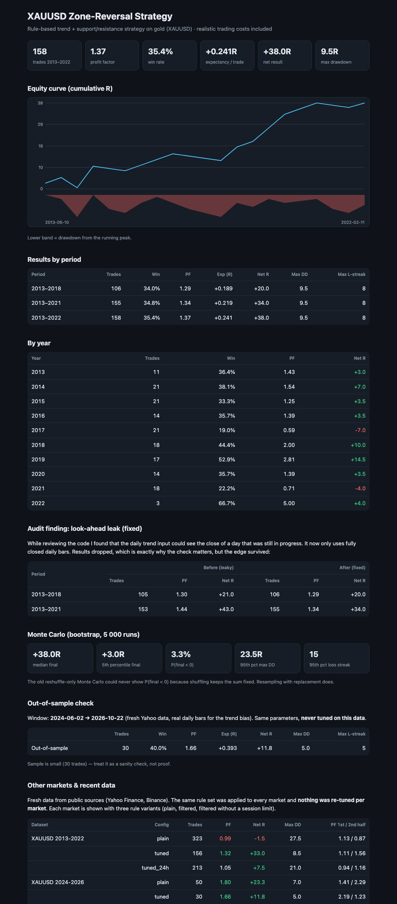
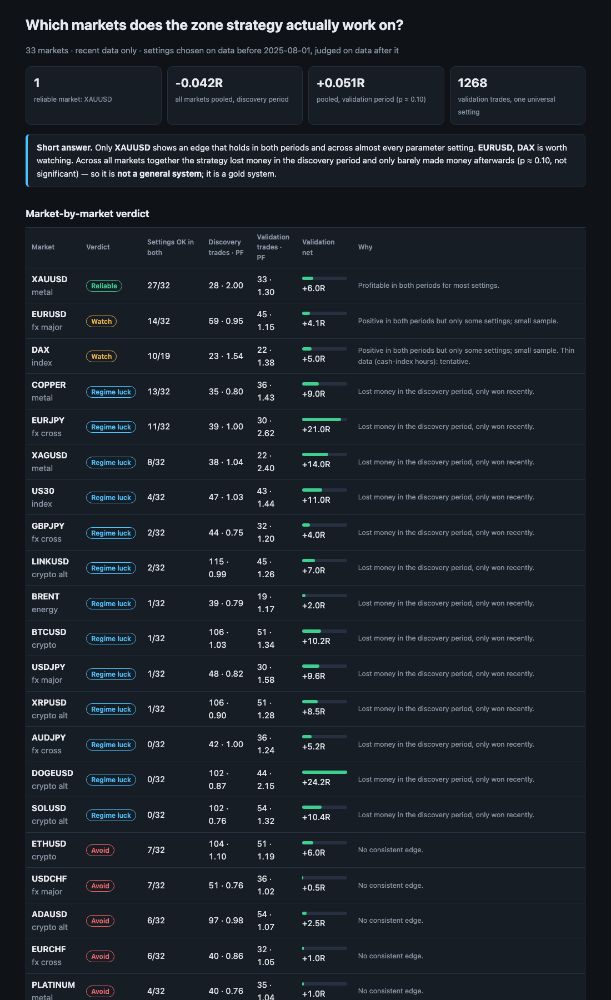

# ATR Zone Research

Rule-based trading research on gold and other markets, from a first backtest to a live signal page.

I wanted a straight answer to a simple question: does a strategy built on support/resistance zones and volatility (ATR) have a real edge, or does it only look good on one lucky backtest? This repo is the record of how I went about answering it, version by version, including the mistakes I found along the way.

> **Note:** this is a showcase of the process and the results. The strategy rules, parameters and source are deliberately not published. Everything that is here (reports, screenshots, helper code) is meant to show how I work, not to be a recipe.

| Version | When | What changed |
|---|---|---|
| [v1](#v1--baseline-backtester) | May 2026 | Backtest engine, walk-forward, Monte Carlo, dashboard |
| [v2](#v2--long-history-validation) | May 2026 | 10 years of gold data, more markets, edge diagnostics |
| [v3](#v3--audit-recent-data-and-a-33-market-scan) | Oct 2026 | Found and fixed a look-ahead bug, re-tested on new data, scanned 33 markets |
| [v4](#v4--live-signal-page) | Oct 2026 | One-command live scanner that outputs entry, stop and target |

## v1 – Baseline backtester

The first working version, for XAUUSD and EURUSD:

- data download with a local cache, support/resistance zones from confirmed pivots, signal generation, and a trade simulator with trading costs
- performance metrics (profit factor, expectancy, drawdown, losing streaks) in units of risk (R)
- walk-forward windows and a Monte Carlo on the trade results
- a forward journal for paper-tracking signals, and a Streamlit dashboard

I made the execution assumptions deliberately pessimistic: entries happen on the next bar's open, costs are charged on every trade, and if the stop and the target are both touched inside one bar, the stop is assumed to have hit first.

## v2 – Long-history validation

Free hourly data only goes back about two years, which is too little to say anything about a strategy. In v2 I added an external CSV loader so I could test gold from 2013 to 2022, plus:

- more instruments (GBPUSD, US30, NAS100, BTC, ETH)
- optional filters for volatility regime, entry quality and trading session
- a diagnostics script that splits results by year, hour, direction, zone age and volatility bucket to see where the edge actually sits
- a live scanner that de-duplicates clustered signals in the journal

The main lesson of this stage: a filter that looks great in the diagnostics is just a description of the past. It needs to survive data it has not seen.

## v3 – Audit, recent data, and a 33-market scan

This is the stage where I stopped trusting my own results and went looking for what could be wrong.

**Audit.** I found a look-ahead leak: the daily trend input could see the close of a day that was still in progress. After fixing it, gold's profit factor on 2013–2021 fell from 1.44 to 1.34 (net result from +43R to +34R). Lower, but the edge survived. I also fixed a crash in the config module, removed a slow per-bar data filter in the scanner, and changed the Monte Carlo to resample with replacement, because reshuffling the same trades can never change the total.

**Fresh data.** I pulled data up to October 2026 and ran gold on a period the rules had never been tuned on: profit factor 1.66 over 30 trades.

**33 markets.** I tested 12 forex pairs, 7 commodities, 6 indices and 8 crypto coins. Settings were chosen only on data before 1 August 2025 and judged on everything after it, so nothing was picked with hindsight.

- Only gold held up in both periods and across almost every setting.
- Pooled over all markets the result was not statistically significant, so this is a gold system, not a general one.
- Many markets (including the JPY pairs) lost money before the cut-off and only won afterwards. I treat that as luck with the recent market, not as an edge.
- Picking each market's best setting looked like +0.26R per trade on the first period and fell to +0.10R on the second. That is selection bias in numbers.

| Gold validation report | 33-market scan |
|---|---|
| [](docs/reports/v3_gold_validation.html) | [](docs/reports/v3_market_scan.html) |

The HTML reports are in [`docs/reports`](docs/reports) (download and open locally).

## What I took from this

- A good backtest is where the work starts. One look-ahead bug was worth roughly a fifth of the reported profit.
- Choosing the best market or setting after the fact inflates results. Fixing the rules first and judging on later data is the only fair test.
- Edges are narrow. One market out of 33 held up, and that is a useful result, not a disappointing one.
- With a win rate around a third, the losing streaks are part of the strategy. Position size has to survive them.

## Not published

The strategy rules, parameter values, filters and the engine source are private. Reports have been edited to remove them. If you would like a walkthrough of how it works, I am happy to do that in conversation.

## Stack

Python (pandas, numpy), Streamlit, HTML/CSS/JavaScript with inline SVG for the reports, public data from Yahoo Finance and Binance.

## What is in this repo

```
docs/images/    screenshots of the reports
docs/reports/   the reports as HTML (open locally)
toolkit/        data download, performance metrics, Monte Carlo
CHANGELOG.md    version history
```

```bash
pip install -r requirements.txt
python toolkit/fetch_data.py GC=F        # downloads hourly + daily gold data into ./data
```

## Disclaimer

Research project. Nothing here is financial advice, and past results do not guarantee future ones.
